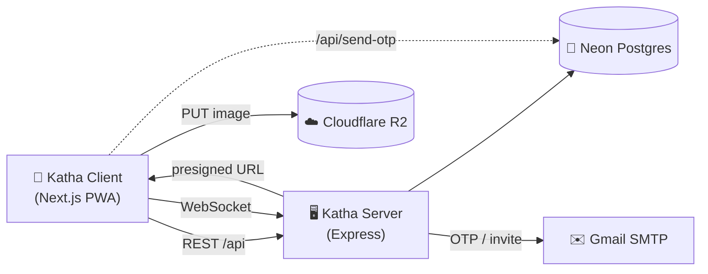

<div align="center">


# 💬 Katha

**A fast, real-time 1-to-1 chat app built as a mobile-friendly PWA.**
Passwordless login with email OTP or Google, live messaging, image sharing, and presence indicators.


</div>

---

## 📖 Table of Contents

- [Overview](#-overview)
- [Features](#-features)
- [Tech Stack](#-tech-stack)
- [Architecture](#-architecture)
- [Project Structure](#-project-structure)
- [Getting Started](#-getting-started)
- [Environment Variables](#-environment-variables)
- [API Reference](#-api-reference)
- [Socket Events](#-socket-events)
- [Database Schema](#-database-schema)
- [Scripts](#-scripts)
- [Docker](#-docker)
- [Security Notes](#-security-notes)
- [Roadmap](#-roadmap)
- [License](#-license)

---

## 🧭 Overview

**Katha** (கதை, "story" or "chat") is a WhatsApp-style messaging app. Users sign in with a one-time code sent to their email, or with Google. They can add contacts by email with a custom name, chat in real time, share compressed images, and block unwanted contacts.

The repo is a two-part monorepo:

| Folder          | What it is                                                              |
| --------------- | ----------------------------------------------------------------------- |
| `katha-client`  | Next.js PWA frontend (UI, auth screens, chat, image compression)        |
| `katha-server`  | Express + Socket.IO backend (auth, contacts, messages, uploads, email)  |

---

## ✨ Features

- 🔐 **Passwordless login** with a 6-digit email OTP or **Google Sign-In**
- 📱 **Single active device.** Logging in elsewhere signs out the previous session.
- ⚡ **Real-time messaging** over WebSockets with delivery status (`SENT` → `DELIVERED` → `READ`)
- ✍️ **Typing indicators** and 🟢 **online/offline presence**
- 🖼️ **Image sharing.** Photos are compressed to WebP in the browser, then uploaded straight to Cloudflare R2 through a presigned URL.
- 🗑️ **Delete for everyone.** Deleted messages show as "This message was deleted".
- 👥 **Contacts with custom names (aliases)**, plus an **email invite** if the person isn't on Katha yet
- 🚫 **Block users.** Blocked users can't send or receive messages.
- 🔴 **Unread counts** and a chat list sorted by the latest message
- 👤 **Profile** with username, avatar, and bio
- 📲 **Installable PWA** with a mobile keyboard-aware chat layout and a dark theme

---

## 🛠 Tech Stack

| Layer      | Technology                                                                          |
| ---------- | ----------------------------------------------------------------------------------- |
| Frontend   | Next.js 16 (App Router), React 19, TypeScript, Tailwind CSS 4, Axios, Lucide, date-fns |
| Realtime   | Socket.IO (client and server)                                                       |
| Backend    | Node.js, Express 5, TypeScript, `tsx`                                               |
| Database   | PostgreSQL on [Neon](https://neon.tech) via Drizzle ORM                             |
| Auth       | Email OTP, Google OAuth (`google-auth-library`, `@react-oauth/google`), JWT         |
| Storage    | Cloudflare R2 (S3-compatible, presigned uploads)                                    |
| Email      | Nodemailer with Gmail SMTP                                                          |
| Images     | `browser-image-compression` (client-side WebP)                                      |

---

## 🏗 Architecture



**Message flow:** a client emits `send_message`, the server checks block status, saves the message to Postgres, updates the conversation timestamp, and pushes `new_message` to the receiver if online. The sender gets an acknowledgment containing the saved message.

**Image flow:** the client compresses the image to WebP, asks the server for a presigned URL, uploads straight to R2, then sends the public URL as an `IMAGE` message.

---

## 📁 Project Structure

```
katha_chat_app/
├── katha-client/                     # Next.js PWA
│   ├── public/                       # manifest.json, icons
│   └── src/
│       ├── app/
│       │   ├── page.tsx              # Main app shell (auth, chat list, chat room)
│       │   ├── layout.tsx            # Metadata, viewport, fonts
│       │   └── api/send-otp/route.ts # OTP email route (Next.js API)
│       ├── components/               # AuthModal, ChatList, ChatRoom,
│       │                             # AddContactModal, ProfileModal
│       └── lib/                      # api (axios), socket, compress, types
│
└── katha-server/                     # Express + Socket.IO API
    ├── Dockerfile
    ├── drizzle.config.ts
    └── src/
        ├── server.ts                 # HTTP + Socket.IO bootstrap
        ├── routes/                   # auth, contact, upload
        ├── sockets/chat.socket.ts    # realtime events
        ├── middlewares/auth.ts       # JWT + active-session check
        ├── services/mail.service.ts  # OTP and invite emails
        ├── config/                   # db (Neon), r2 (S3 client)
        └── db/schema.ts              # Drizzle schema
```

---

## 🚀 Getting Started

### Prerequisites

- **Node.js** 20 or newer and **npm** (or pnpm)
- A **[Neon](https://neon.tech)** Postgres database
- A **Gmail account with an App Password** (for OTP emails)
- A **[Cloudflare R2](https://developers.cloudflare.com/r2/)** bucket with public access enabled (for images)
- *(Optional)* A **Google OAuth Client ID** for Google Sign-In

### 1. Clone

```bash
git clone https://github.com/Puviraj-2004/katha_chat_app.git
cd katha_chat_app
```

### 2. Set up the server

```bash
cd katha-server
npm install
cp .env.example .env          # then fill in YOUR OWN values (see below)
npx drizzle-kit push          # create the database tables
npm run dev                   # http://localhost:5000
```

### 3. Set up the client

```bash
cd ../katha-client
npm install
cp .env.example .env.local    # if missing, create it using the variables below
npm run dev                   # http://localhost:3000
```

Open **http://localhost:3000**, enter your email, and sign in with the OTP.

---

## 🔐 Environment Variables

### Server (`katha-server/.env`)

| Variable                | Required | Description                                                        |
| ----------------------- | -------- | ------------------------------------------------------------------ |
| `PORT`                  | No       | Server port (default `5000`)                                       |
| `DATABASE_URL`          | Yes      | Neon pooled connection string                                      |
| `JWT_SECRET`            | Yes      | Long random secret used to sign tokens                             |
| `SMTP_USER`             | Yes      | Gmail address that sends OTP and invite emails                     |
| `SMTP_PASS`             | Yes      | Gmail **App Password**                                             |
| `R2_ACCOUNT_ID`         | Yes      | Cloudflare account ID                                              |
| `R2_ACCESS_KEY_ID`      | Yes      | R2 access key                                                      |
| `R2_SECRET_ACCESS_KEY`  | Yes      | R2 secret key                                                      |
| `R2_BUCKET_NAME`        | Yes      | R2 bucket name                                                     |
| `R2_PUBLIC_DOMAIN`      | Yes      | Public bucket URL, for example `https://pub-xxxx.r2.dev`           |
| `GOOGLE_CLIENT_ID`      | For Google login | Google OAuth Client ID                                     |

### Client (`katha-client/.env.local`)

| Variable                        | Required | Description                                                              |
| ------------------------------- | -------- | ------------------------------------------------------------------------ |
| `NEXT_PUBLIC_API_URL`           | Yes      | Server REST base URL **including `/api`**, e.g. `http://localhost:5000/api` |
| `NEXT_PUBLIC_SOCKET_URL`        | No       | Socket server URL (default `http://localhost:5000`)                      |
| `NEXT_PUBLIC_GOOGLE_CLIENT_ID`  | For Google login | Google OAuth Client ID                                           |
| `DATABASE_URL`                  | Yes      | Same Neon URL (used by the client's `/api/send-otp` route)               |
| `SMTP_USER` / `SMTP_PASS`       | Yes      | Same Gmail credentials (used by `/api/send-otp`)                         |

> ⚠️ Never commit real keys. `.env` and `.env.local` are already git-ignored.

---

## 📡 API Reference

All routes are under `/api` and, except where noted, need the header `Authorization: Bearer <token>`.

### 🔑 Auth: `/api/auth`

| Method | Route         | Auth | Description                                                       |
| ------ | ------------- | ---- | ----------------------------------------------------------------- |
| POST   | `/send-otp`   | No   | Generate and email a 6-digit OTP (`{ email }`)                    |
| POST   | `/verify-otp` | No   | Verify OTP, create the user if new, return `{ token, user, isNewUser }` |
| POST   | `/google`     | No   | Sign in with a Google credential (`{ credential }`)               |
| POST   | `/onboard`    | Yes  | Set username and avatar (`{ username, avatarUrl }`)               |

### 👥 Contacts and messages: `/api/contacts`

| Method | Route                       | Description                                                          |
| ------ | --------------------------- | -------------------------------------------------------------------- |
| GET    | `/list`                     | Chat list with last message and unread counts                        |
| POST   | `/add`                      | Add a contact (`{ email, customName }`) or send an invite email if not registered |
| POST   | `/block`                    | Block a user (`{ targetUserId }`)                                    |
| GET    | `/messages/:conversationId` | Message history; marks the partner's messages as read                |

### 🖼️ Uploads: `/api/upload`

| Method | Route            | Description                                                    |
| ------ | ---------------- | -------------------------------------------------------------- |
| POST   | `/presigned-url` | Returns `{ uploadUrl, publicUrl }` (valid for 5 minutes)       |

### ❤️ Health

`GET /health` returns `{ "status": "Katha backend running fast ⚡" }`

---

## 🔌 Socket Events

The client connects with `auth: { userId }`.

| Event                        | Direction        | Purpose                                         |
| ---------------------------- | ---------------- | ----------------------------------------------- |
| `send_message`               | Client → Server  | Send a message (with an ack callback)           |
| `new_message`                | Server → Client  | Deliver a message to the receiver               |
| `typing_start` / `typing_stop` | Client → Server | Typing state                                    |
| `user_typing`                | Server → Client  | Partner typing state                            |
| `check_presence`             | Client → Server  | Ask if a user is online                         |
| `presence_status`            | Server → Client  | Reply to `check_presence`                       |
| `user_presence`              | Server → Clients | Broadcast when a user goes online or offline    |
| `mark_read` / `messages_read`| Both             | Read receipts                                   |
| `delete_message` / `message_deleted` | Both     | Delete for everyone                             |
| `chat_list_updated`          | Server → Client  | Refresh the chat list                           |

---

## 🗄 Database Schema

Managed with **Drizzle ORM** (`katha-server/src/db/schema.ts`).

| Table           | Purpose                                                    |
| --------------- | ---------------------------------------------------------- |
| `users`         | Email, username, avatar, bio                               |
| `otps`          | Email verification codes with expiry                       |
| `sessions`      | JWT sessions (one active session per user)                 |
| `contacts`      | Saved contacts with a custom name (unique per user pair)   |
| `blocked_users` | Block relationships                                        |
| `conversations` | 1-to-1 conversations with `last_message_at`                |
| `messages`      | Text or image messages with status and soft-delete flag    |

```bash
npx drizzle-kit push      # apply the schema to your database
```

---

## 📜 Scripts

**Server**

| Command         | Description                         |
| --------------- | ----------------------------------- |
| `npm run dev`   | Start with hot reload (`tsx watch`) |
| `npm run build` | Compile TypeScript to `dist/`       |
| `npm start`     | Run `src/server.ts` with `tsx`      |

**Client**

| Command         | Description              |
| --------------- | ------------------------ |
| `npm run dev`   | Start the Next.js dev server |
| `npm run build` | Production build         |
| `npm start`     | Run the production build |
| `npm run lint`  | Run ESLint               |

---

## 🐳 Docker

The server includes a multi-stage `Dockerfile` (Node 20 Alpine).

```bash
cd katha-server
docker build -t katha-server .
docker run -p 8000:8000 -e PORT=8000 --env-file .env katha-server
```

The image exposes port `8000`, so set `PORT=8000` as shown (or change `EXPOSE` in the Dockerfile).

---

## 🔒 Security Notes

Worth fixing before using Katha with real users:

- 🚨 **Keep real secrets out of Git.** If real keys were ever committed (for example in `.env.example`), **rotate them** (Gmail App Password, R2 keys, JWT secret, DB password) and replace the file contents with placeholders.
- 🔑 **Remove hard-coded fallbacks.** The server falls back to a default JWT secret and a built-in Google Client ID when env vars are missing. It should fail to start instead.
- 🙈 **Don't log OTPs.** `auth.routes.ts` prints each generated OTP to the console.
- 🔌 **Authenticate sockets.** The socket `userId` comes from the client handshake without verification. Validate the JWT during the socket handshake.
- 🌍 **Restrict CORS.** Both Express and Socket.IO currently allow any origin (`*`).
- 🛡️ **Rate-limit OTP and login routes** and limit OTP verification attempts.

---

## 🗺 Roadmap

- [ ] Verify JWT on the socket connection and tighten CORS
- [ ] Rate limiting and OTP attempt limits
- [ ] Group chats
- [ ] Push notifications and offline support (service worker)
- [ ] Message reply, reactions, and voice notes
- [ ] End-to-end encryption (the schema already has an `is_encrypted` flag)
- [ ] Tests and CI

---

## 📄 License

No license file is included yet. Add a `LICENSE` file (for example MIT) if you want others to use or contribute to the code.

---

<div align="center">

Built with ❤️ by [Puviraj](https://github.com/Puviraj-2004)

</div>
